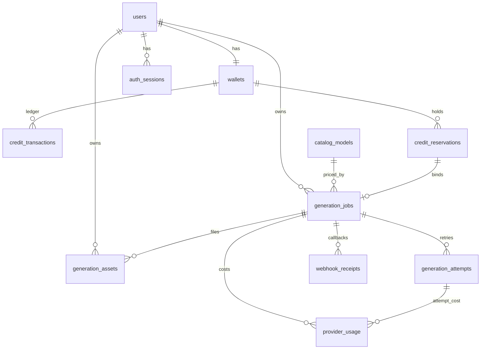

# KELBET AI v0.3 — Data Model (ER)

**Status:** Draft for approval (no code until confirmed)  
**Source of truth:** PostgreSQL  
**Constraint:** Migration `0001_initial` is immutable; all changes are additive revisions.

Related: [KELBET_V03_PLAN.md](./KELBET_V03_PLAN.md) · [GENERATION_STATE_MACHINE.md](./GENERATION_STATE_MACHINE.md)

---

## 1. ER overview

```text
users 1──1 wallets 1──* credit_transactions
  │           │
  │           └──* credit_reservations *──1 generation_jobs
  │
  ├──* auth_sessions
  ├──* generation_jobs 1──* generation_attempts
  │         │            1──* generation_assets
  │         │            1──* provider_usage
  │         └──* generation_job_events (optional audit)
  │
  └──* uploads (input assets pending / bound)

catalog_models (standalone, referenced by generation_jobs.model_id)
feature_flags (standalone)
```

---

## 2. Existing tables (preserve)

### 2.1 `users` (0001_initial)

| Column | Type | Notes |
|--------|------|--------|
| `id` | UUID PK | |
| `telegram_id` | BIGINT UNIQUE | identity for bot + Mini App |
| `username` | VARCHAR(255) NULL | |
| `language` | VARCHAR(5) | `ru` \| `kk` |
| `plan` | VARCHAR(32) | currently `free` |
| `created_at` / `updated_at` | TIMESTAMPTZ | |

**v0.3 additive columns (migration 0002):**

| Column | Type | Notes |
|--------|------|--------|
| `is_blocked` | BOOLEAN NOT NULL DEFAULT false | soft ban |
| `last_seen_at` | TIMESTAMPTZ NULL | Mini App / bot activity |

### 2.2 `wallets` (0001_initial)

| Column | Type | Notes |
|--------|------|--------|
| `id` | UUID PK | |
| `user_id` | UUID UNIQUE FK → users | CASCADE |
| `balance` | INT NOT NULL, CHECK ≥ 0 | total credits owned |
| `version` | INT NOT NULL | bumped on money-moving ops |
| `created_at` / `updated_at` | TIMESTAMPTZ | |

**v0.3 additive columns:**

| Column | Type | Notes |
|--------|------|--------|
| `reserved` | INT NOT NULL DEFAULT 0, CHECK ≥ 0 | soft-held credits |
| CHECK | `balance >= reserved` | available = balance − reserved |

Semantics:

- `balance` — owned credits (including held).
- `reserved` — currently held for in-flight jobs.
- `available = balance - reserved` — spendable for new quotes/reserves.
- Ledger rows are written only on **capture** (debit) and **release is not a ledger credit** when using soft-hold; **refund** after capture writes a credit row. See wallet flow in the plan.

### 2.3 `credit_transactions` (0001_initial)

Immutable ledger. No schema change required for core columns.

| Column | Type | Notes |
|--------|------|--------|
| `id` | UUID PK | |
| `wallet_id` | UUID FK → wallets | |
| `amount` | INT | signed: +credit / −debit |
| `balance_after` | INT | snapshot of `wallets.balance` |
| `type` | VARCHAR(32) | `credit` \| `debit` |
| `reason` | VARCHAR(64) | extended enums below |
| `idempotency_key` | VARCHAR(128) UNIQUE | |
| `meta` | JSONB NULL | no prompt text |
| `created_at` | TIMESTAMPTZ | |

**New `TxReason` values (app enum; DB remains string):**

| Reason | Direction | When |
|--------|-----------|------|
| `welcome_bonus` | credit | existing |
| `ai_chat` | debit | existing (sync chat) |
| `generation_capture` | debit | finalize reservation |
| `generation_refund` | credit | post-capture refund |
| `admin_adjust` | either | future ops (feature-flagged) |
| `plan_grant` | credit | future plans/top-ups |

Idempotency key patterns:

| Op | Key |
|----|-----|
| Welcome | `welcome:{user_id}` |
| Chat | `chat:{request_id}` |
| Capture | `capture:{reservation_id}` |
| Refund | `refund:{reservation_id}` or `refund:{generation_id}:{n}` |

---

## 3. New tables

### 3.1 `auth_sessions`

Short-lived server sessions for Mini App (opaque token hash stored; raw token only in client).

| Column | Type | Notes |
|--------|------|--------|
| `id` | UUID PK | |
| `user_id` | UUID FK → users ON DELETE CASCADE | |
| `token_hash` | CHAR(64) UNIQUE | SHA-256 of bearer token |
| `telegram_auth_date` | TIMESTAMPTZ NOT NULL | from initData |
| `init_data_hash` | CHAR(64) NOT NULL | HMAC digest of validated initData (replay binding) |
| `expires_at` | TIMESTAMPTZ NOT NULL | e.g. 24h or 1h sliding |
| `revoked_at` | TIMESTAMPTZ NULL | logout / rotate |
| `user_agent` | VARCHAR(512) NULL | optional |
| `ip_hash` | CHAR(64) NULL | optional privacy-preserving |
| `created_at` / `updated_at` | TIMESTAMPTZ | |

Indexes: `(user_id)`, `(expires_at)` WHERE `revoked_at IS NULL`.

Replay: Redis key `tg_init:{init_data_hash}` TTL = max(auth_date window, session issue window); DB unique on recent hashes optional.

### 3.2 `catalog_models`

Server-side model catalog. Frontend never hardcodes prices.

| Column | Type | Notes |
|--------|------|--------|
| `id` | UUID PK | |
| `slug` | VARCHAR(64) UNIQUE | stable API id, e.g. `runway-gen4-image` |
| `modality` | VARCHAR(32) NOT NULL | `text` \| `image` \| `image_edit` \| `video` \| `upscale` |
| `provider` | VARCHAR(32) NOT NULL | `openrouter` \| `runway` \| `mock` \| … |
| `provider_model_id` | VARCHAR(128) NOT NULL | upstream model string |
| `display_order` | INT NOT NULL DEFAULT 100 | |
| `enabled` | BOOLEAN NOT NULL DEFAULT true | |
| `deprecated_at` | TIMESTAMPTZ NULL | soft deprecation |
| `replacement_slug` | VARCHAR(64) NULL | optional |
| `feature_flag` | VARCHAR(64) NULL | if set, require flag |
| `user_credit_price` | INT NOT NULL, CHECK > 0 | **what user pays** |
| `provider_cost_units` | INT NOT NULL DEFAULT 0, CHECK ≥ 0 | internal cost in **milli-credits or USD micros** — integer only; unit documented in settings (`PROVIDER_COST_UNIT=usd_micros`) |
| `currency_hint` | VARCHAR(8) NULL | display only, e.g. `USD` for ops |
| `capabilities` | JSONB NOT NULL | see schema below |
| `input_requirements` | JSONB NOT NULL | see schema below |
| `localization` | JSONB NOT NULL | `{ "ru": {...}, "kk": {...} }` |
| `pricing_rules` | JSONB NULL | duration/resolution multipliers (integer factors) |
| `created_at` / `updated_at` | TIMESTAMPTZ | |

**`capabilities` (example):**

```json
{
  "aspect_ratios": ["1:1", "16:9", "9:16"],
  "resolutions": ["720p", "1080p"],
  "durations_sec": [5, 10],
  "max_prompt_chars": 2000,
  "supports_negative_prompt": false,
  "supports_seed": true,
  "max_outputs": 1
}
```

**`input_requirements` (example):**

```json
{
  "prompt": "required",
  "source_image": "optional",
  "mask_image": "forbidden",
  "accepted_mime": ["image/jpeg", "image/png", "image/webp"],
  "max_input_bytes": 10485760
}
```

**`localization` (example):**

```json
{
  "ru": { "name": "Изображение Gen-4", "description": "…" },
  "kk": { "name": "Gen-4 сурет", "description": "…" }
}
```

Seeded via migration data + admin/ops updates later. Never trust client-sent price.

### 3.3 `credit_reservations`

| Column | Type | Notes |
|--------|------|--------|
| `id` | UUID PK | |
| `wallet_id` | UUID FK → wallets | |
| `user_id` | UUID FK → users | denormalized for ownership checks |
| `generation_id` | UUID NULL FK → generation_jobs | set when job created |
| `amount` | INT NOT NULL, CHECK > 0 | user credit units held |
| `status` | VARCHAR(32) NOT NULL | `held` \| `captured` \| `released` \| `expired` |
| `idempotency_key` | VARCHAR(128) UNIQUE | client/server key for reserve |
| `quote_snapshot` | JSONB NOT NULL | model_id, price, pricing_rules applied, catalog version |
| `capture_tx_id` | UUID NULL FK → credit_transactions | |
| `refund_tx_id` | UUID NULL FK → credit_transactions | |
| `expires_at` | TIMESTAMPTZ NOT NULL | stale hold sweeper |
| `held_at` / `finalized_at` | TIMESTAMPTZ | |
| `created_at` / `updated_at` | TIMESTAMPTZ | |

Indexes: `(wallet_id, status)`, `(expires_at)` WHERE `status = 'held'`, `(generation_id)`.

Invariant: at most one active (`held`) reservation per generation; capture/release/refund are terminal and idempotent.

### 3.4 `generation_jobs`

| Column | Type | Notes |
|--------|------|--------|
| `id` | UUID PK | public `generation_id` |
| `user_id` | UUID FK → users | |
| `model_id` | UUID FK → catalog_models | |
| `modality` | VARCHAR(32) NOT NULL | denormalized from catalog |
| `status` | VARCHAR(32) NOT NULL | see state machine doc |
| `idempotency_key` | VARCHAR(128) NOT NULL | UNIQUE(user_id, idempotency_key) |
| `request_hash` | CHAR(64) NOT NULL | SHA-256 of canonical request |
| `prompt_redacted` | BOOLEAN NOT NULL DEFAULT true | prompts stored separately/encrypted or omitted from logs |
| `params` | JSONB NOT NULL | aspect, resolution, duration, seed — **no raw secrets** |
| `prompt_storage_key` | VARCHAR(512) NULL | optional encrypted object or DB vault ref; prefer not logging |
| `input_asset_ids` | UUID[] NULL | or junction table |
| `reservation_id` | UUID NULL FK → credit_reservations | |
| `user_credit_price` | INT NOT NULL | snapshot at quote time |
| `provider` | VARCHAR(32) NOT NULL | |
| `provider_model_id` | VARCHAR(128) NOT NULL | |
| `provider_job_id` | VARCHAR(128) NULL | upstream async id |
| `progress_pct` | INT NOT NULL DEFAULT 0, CHECK 0–100 | |
| `progress_stage` | VARCHAR(64) NULL | `queued` \| `uploading` \| `generating` \| … |
| `error_code` | VARCHAR(64) NULL | stable machine code |
| `error_class` | VARCHAR(32) NULL | `user` \| `provider` \| `internal` \| `timeout` |
| `attempt_count` | INT NOT NULL DEFAULT 0 | |
| `max_attempts` | INT NOT NULL DEFAULT 3 | |
| `queued_at` / `started_at` / `finished_at` | TIMESTAMPTZ NULL | |
| `cancel_requested_at` | TIMESTAMPTZ NULL | |
| `dead_letter_at` | TIMESTAMPTZ NULL | |
| `next_poll_at` | TIMESTAMPTZ NULL | polling fallback |
| `webhook_last_event_id` | VARCHAR(128) NULL | duplicate webhook protection |
| `correlation_id` | UUID NOT NULL | tracing |
| `created_at` / `updated_at` | TIMESTAMPTZ | |

Indexes:

- `(user_id, created_at DESC)` — history
- `(status, next_poll_at)` — poller / sweeper
- `(provider, provider_job_id)` UNIQUE WHERE `provider_job_id IS NOT NULL`
- `(status)` WHERE status IN active set

### 3.5 `generation_attempts`

| Column | Type | Notes |
|--------|------|--------|
| `id` | UUID PK | |
| `generation_id` | UUID FK → generation_jobs ON DELETE CASCADE | |
| `attempt_no` | INT NOT NULL | 1..N |
| `status` | VARCHAR(32) NOT NULL | `started` \| `succeeded` \| `failed` \| `timed_out` \| `cancelled` |
| `provider_request_id` | VARCHAR(128) NULL | |
| `provider_job_id` | VARCHAR(128) NULL | |
| `latency_ms` | INT NULL | |
| `error_code` | VARCHAR(64) NULL | |
| `error_message_safe` | VARCHAR(512) NULL | sanitized, no user prompt |
| `raw_response_meta` | JSONB NULL | status codes, headers subset — no bodies with PII |
| `started_at` / `finished_at` | TIMESTAMPTZ | |
| UNIQUE | `(generation_id, attempt_no)` | |

### 3.6 `generation_assets`

| Column | Type | Notes |
|--------|------|--------|
| `id` | UUID PK | |
| `generation_id` | UUID NULL FK → generation_jobs | NULL for unbound uploads |
| `user_id` | UUID FK → users | ownership |
| `role` | VARCHAR(32) NOT NULL | `input` \| `mask` \| `output` \| `thumb` |
| `storage_backend` | VARCHAR(32) NOT NULL | `r2` |
| `bucket` | VARCHAR(128) NOT NULL | |
| `object_key` | VARCHAR(512) NOT NULL | UUID-based safe name |
| `content_type` | VARCHAR(128) NOT NULL | validated |
| `byte_size` | INT NOT NULL | |
| `sha256` | CHAR(64) NULL | after finalize |
| `magic_ok` | BOOLEAN NOT NULL DEFAULT false | magic-byte check passed |
| `visibility` | VARCHAR(32) NOT NULL | `private` |
| `retention_class` | VARCHAR(32) NOT NULL | `temp_input` \| `permanent_output` |
| `expires_at` | TIMESTAMPTZ NULL | temp inputs |
| `deleted_at` | TIMESTAMPTZ NULL | soft delete / GC |
| `created_at` / `updated_at` | TIMESTAMPTZ | |
| UNIQUE | `(bucket, object_key)` | |

**No user-supplied URLs as fetch sources** — only `asset_id` references after upload. Prevents SSRF.

### 3.7 `provider_usage`

| Column | Type | Notes |
|--------|------|--------|
| `id` | UUID PK | |
| `generation_id` | UUID FK → generation_jobs | |
| `attempt_id` | UUID NULL FK → generation_attempts | |
| `provider` | VARCHAR(32) NOT NULL | |
| `provider_model_id` | VARCHAR(128) NOT NULL | |
| `modality` | VARCHAR(32) NOT NULL | |
| `provider_cost_units` | INT NOT NULL DEFAULT 0 | integer micros / milli |
| `user_credit_price` | INT NOT NULL | snapshot |
| `latency_ms` | INT NULL | |
| `http_status` | INT NULL | |
| `tokens_in` / `tokens_out` | INT NULL | text models |
| `meta` | JSONB NULL | non-sensitive |
| `created_at` | TIMESTAMPTZ | |

### 3.8 `webhook_receipts`

Duplicate webhook protection (provider callbacks).

| Column | Type | Notes |
|--------|------|--------|
| `id` | UUID PK | |
| `provider` | VARCHAR(32) NOT NULL | |
| `event_id` | VARCHAR(128) NOT NULL | provider delivery id |
| `generation_id` | UUID NULL | |
| `payload_hash` | CHAR(64) NOT NULL | |
| `processed_at` | TIMESTAMPTZ NOT NULL | |
| UNIQUE | `(provider, event_id)` | |

### 3.9 `feature_flags`

| Column | Type | Notes |
|--------|------|--------|
| `key` | VARCHAR(64) PK | |
| `enabled` | BOOLEAN NOT NULL | |
| `payload` | JSONB NULL | percentage rollout, allowlist telegram_ids |
| `updated_at` | TIMESTAMPTZ | |

---

## 4. Relationship diagram (Mermaid)



---

## 5. Integer money rules

1. All user-facing amounts: **integer credit units** (`INT`).
2. All provider costs: **integer** in a fixed subunit (`provider_cost_units`), never `float`/`Numeric` for money paths.
3. Pricing multipliers in `pricing_rules` are integer factors or rational pairs `(num, den)` stored as ints; final price computed with integer arithmetic and explicit rounding mode (ceil to user).
4. DB CHECKs enforce `balance >= 0`, `reserved >= 0`, `balance >= reserved`, positive prices.

---

## 6. Retention & GC

| Class | Default policy (config) |
|-------|-------------------------|
| `temp_input` | delete object + soft-delete row after 24–72h if unused / after job terminal + grace |
| `permanent_output` | retain while account active; soft-delete on user delete request |
| `auth_sessions` | purge expired/revoked daily |
| `webhook_receipts` | retain 30 days |
| `credit_reservations` held past `expires_at` | sweeper → `expired` + release reserved |

---

## 7. Migration plan (schema only)

| Rev | Contents |
|-----|----------|
| `0001_initial` | **DO NOT MODIFY** — users, wallets, credit_transactions |
| `0002_wallet_reserved` | `wallets.reserved` + CHECKs; minimal `credit_reservations` (generation_id nullable, no FK yet) |
| `0003_auth_sessions` | `auth_sessions` |
| `0004_catalog_models` | `catalog_models` + seed mock/openrouter/runway rows |
| `0005_generations` | `generation_jobs`, `generation_attempts`, `generation_assets`, `provider_usage`, `webhook_receipts`; FK `credit_reservations.generation_id` |
| `0006_feature_flags` | `feature_flags` + seed |

> Note: Soft-hold reservations landed in `0002` with Stage B (ahead of original `0005`) so wallet primitives are testable without the full generation schema.
