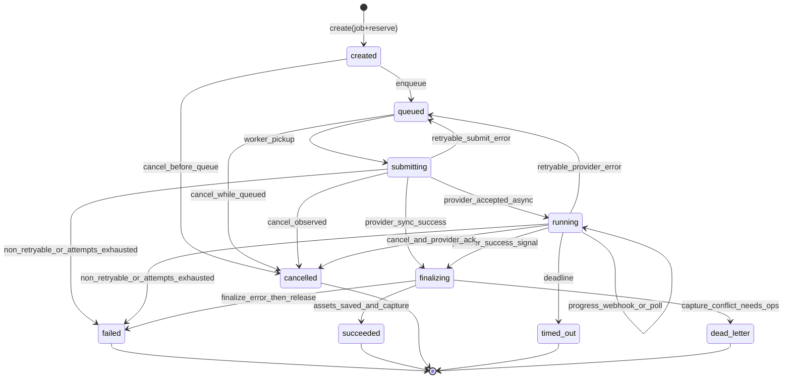

# KELBET AI v0.3 — Generation Job State Machine

**Status:** Draft for approval (no code until confirmed)  
**Related:** [KELBET_V03_PLAN.md](./KELBET_V03_PLAN.md) · [DATA_MODEL.md](./DATA_MODEL.md)

---

## 1. Goals

- Exactly-once **business** effect for credits: hold → capture XOR release (refund only after capture).
- Crash-safe transitions: every status change is a **PostgreSQL transaction** with row lock on `generation_jobs`.
- Providers are unreliable: retries, timeouts, webhooks + polling fallback, dead-letter.
- Handlers/routes never mutate status directly — only `GenerationService` / `GenerationStateMachine`.

---

## 2. Status enum

| Status | Terminal? | Meaning |
|--------|-----------|---------|
| `created` | no | Job row inserted; reservation may already be `held` |
| `queued` | no | Enqueued to ARQ (`text` / `image` / `video`) |
| `submitting` | no | Worker calling provider create API |
| `running` | no | Provider accepted; waiting webhook and/or poll |
| `finalizing` | no | Downloading/storing outputs, preparing capture |
| `succeeded` | **yes** | Outputs persisted; credits **captured** |
| `failed` | **yes** | Exhausted retries or non-retryable error; credits **released** (if held) |
| `cancelled` | **yes** | User/system cancel honored; credits **released** |
| `timed_out` | **yes** | Global job deadline exceeded; credits **released** |
| `dead_letter` | **yes** | Needs ops attention; credits already released or captured per last known safe path |

Notes:

- `dead_letter` is for “we cannot safely auto-complete wallet side without human/ops rule”. Prefer auto `failed` + release whenever safe.
- Sync text via OpenRouter may skip `running` (submit → finalize in one attempt) but still records attempts.

---

## 3. Diagram



---

## 4. Allowed transitions

| From | To | Guard / action |
|------|----|----------------|
| `created` | `queued` | Reservation `held`; enqueue ARQ with `generation_id` |
| `created` | `cancelled` | Release reservation; no provider call |
| `queued` | `submitting` | Claim job (`SELECT FOR UPDATE`), bump attempt, set `started_at` |
| `queued` | `cancelled` | Remove/ignore queue message; release reservation |
| `submitting` | `running` | Persist `provider_job_id`; set `next_poll_at` |
| `submitting` | `finalizing` | Sync provider returned bytes/URL already |
| `submitting` | `queued` | Retryable; `attempt_count < max_attempts`; backoff |
| `submitting` | `failed` | Non-retryable or attempts exhausted → **release** |
| `submitting` | `cancelled` | Cancel flag set before/during submit |
| `running` | `running` | Progress update only (`progress_pct`, stage); same status |
| `running` | `finalizing` | Success webhook/poll; verify not duplicate |
| `running` | `queued` | Retryable failure with new attempt |
| `running` | `failed` | Terminal failure → **release** |
| `running` | `timed_out` | `now > deadline` → best-effort provider cancel → **release** |
| `running` | `cancelled` | Cancel requested + safe to stop → **release** |
| `finalizing` | `succeeded` | Store assets; **capture** reservation (idempotent) |
| `finalizing` | `failed` | Cannot store outputs → **release** if still held |
| `finalizing` | `dead_letter` | Inconsistent wallet/job state |

Any other transition → raise `InvalidGenerationTransitionError` (domain).

---

## 5. Transactional transition protocol

Every transition runs inside one DB transaction:

1. `SELECT generation_jobs WHERE id=:id FOR UPDATE`.
2. Assert `current_status == expected_from` (optimistic guard + lock).
3. Perform side-table writes (`generation_attempts`, assets metadata, reservation).
4. Wallet ops (`reserve` already done at create; `capture` / `release` / `refund` here).
5. Update job status + timestamps.
6. Commit.
7. **After commit:** enqueue next ARQ task, emit metrics, notify Telegram (best-effort).

External I/O (provider HTTP, R2 upload) **must not** hold the row lock across network calls:

- Pattern A: transition to `submitting` → commit → call provider → new transaction to `running`/`failed`.
- Pattern B: use attempt row `started` without long locks.

---

## 6. Wallet coupling

| Job event | Reservation | Ledger |
|-----------|-------------|--------|
| Job create | `held` (`reserved += amount`) | none |
| `succeeded` via `finalizing` | `captured` | debit `generation_capture` / key `capture:{reservation_id}` |
| `failed` / `cancelled` / `timed_out` (while held) | `released` | none (`reserved -= amount`) |
| Post-success refund (ops/policy) | already `captured` | credit `generation_refund` |
| Expired hold sweeper | `expired` ≈ release | none |

**Invariant:** for a given `reservation_id`, at most one of capture or release succeeds. Both methods are idempotent.

**Negative balance impossible:** `capture` uses `FOR UPDATE` on wallet and requires `balance >= amount` and `reserved >= amount`; then `balance -= amount`, `reserved -= amount`. Soft-hold already ensured funds at reserve time; capture only converts hold → spend.

---

## 7. Idempotency & request hash

### 7.1 Client idempotency

- Header/body: `Idempotency-Key` (UUID or opaque ≤128 chars).
- Unique `(user_id, idempotency_key)` on `generation_jobs`.
- Replay returns the **same** `generation_id` and current status (HTTP 200), does not double-reserve.

### 7.2 Request hash

Canonical JSON (sorted keys) of:

- `model_slug`
- normalized `params`
- ordered `input_asset_ids`
- prompt length + content hash (store hash; avoid logging prompt)

`request_hash = sha256(canonical)`. Used for analytics and optional dedupe warnings; **not** a substitute for idempotency key.

---

## 8. Retries

| Class | Examples | Action |
|-------|----------|--------|
| Retryable | 429, 502, 503, timeout, connection reset | new `generation_attempts` row; backoff; stay/reenter `queued` |
| Non-retryable | 400 validation, content policy, auth to provider | `failed` + release |
| Ambiguous | 500 after unknown accept | poll by `provider_job_id` if known; else cautious retry with provider idempotency key |

Backoff: exponential with jitter, capped; modality-specific (`text` short, `video` long).

`max_attempts` default 3 (catalog/settings override per modality).

---

## 9. Timeouts

| Timer | Scope | On fire |
|-------|-------|---------|
| Provider HTTP timeout | single attempt request | retryable failure |
| Attempt timeout | wall clock per attempt | mark attempt `timed_out` |
| Job deadline | e.g. text 2m, image 10m, video 30m | job → `timed_out`, release |
| Reservation TTL | hold without progress | sweeper releases if job not active |

---

## 10. Cancellation

1. API `POST /generations/{id}/cancel` sets `cancel_requested_at`.
2. If status ∈ {`created`,`queued`}: transition `cancelled` + release immediately.
3. If `submitting`/`running`: set flag; worker checks between steps; best-effort `provider.cancel` if supported.
4. If already `finalizing` with assets nearly done: prefer completing to `succeeded` **or** fail-safe release policy documented in ADR (default: if capture not done and outputs not durable → cancel/fail + release).
5. Terminal states: cancel → `409 Conflict`.

---

## 11. Webhooks & duplicate protection

1. Verify `webhook secret` / signature **before** parsing body.
2. Insert `webhook_receipts (provider, event_id)` — on unique violation, return 200 and no-op.
3. Map event → `generation_id` via `provider_job_id`.
4. Apply transition only if allowed; ignore stale events (e.g. progress after `succeeded`).
5. Always ACK 200 for duplicates to stop provider retries.

---

## 12. Polling fallback

Worker or dedicated poll loop:

- Select jobs `status = 'running' AND next_poll_at <= now()` FOR UPDATE SKIP LOCKED.
- Call `provider.get_status(provider_job_id)`.
- Update progress or transition.
- Schedule `next_poll_at` with modality-specific interval.

Webhooks are primary when available; polling is mandatory fallback.

---

## 13. Dead-letter & stuck job recovery

**Stuck detector** (periodic ARQ cron):

- `submitting`/`finalizing` older than threshold without heartbeat → requeue or fail.
- `queued` with no ARQ message (reconcile) → re-enqueue.
- `running` past deadline → `timed_out`.

**Dead-letter** when:

- Capture fails after outputs stored (disk/R2 ok, wallet conflict).
- Double-finalization race that cannot be auto-resolved.

Ops runbook: inspect reservation + ledger idempotency keys; prefer compensating **release** if user never received asset, else **capture** if asset delivered.

---

## 14. Progress model

Exposed to Mini App:

```json
{
  "status": "running",
  "progress_pct": 40,
  "progress_stage": "generating",
  "cancelable": true
}
```

Stages (informative): `queued` → `submitting` → `generating` → `downloading` → `finalizing` → `done`.

---

## 15. Notification (Telegram)

After terminal transition (best-effort, after commit):

- Bot sends result media or failure/cancel message in user language.
- Failures of notify do **not** roll back job status (outbox optional in later phase; v0.3: retry notify via ARQ `notify` task).

---

## 16. Test matrix (state machine)

| Case | Expect |
|------|--------|
| Happy path mock image | created→…→succeeded, reservation captured, 1 debit ledger |
| Provider fail then success | 2 attempts, one capture |
| Non-retryable | failed, reserved released, no debit |
| Cancel while queued | cancelled, released |
| Cancel while running | cancelled or failed per provider, released |
| Duplicate webhook | second no-op, single capture |
| Duplicate idempotency create | same generation_id |
| Concurrent reserve | one wins, other insufficient |
| Job timeout | timed_out, released |
| Finalize capture idempotent | replay capture key → applied=false |
